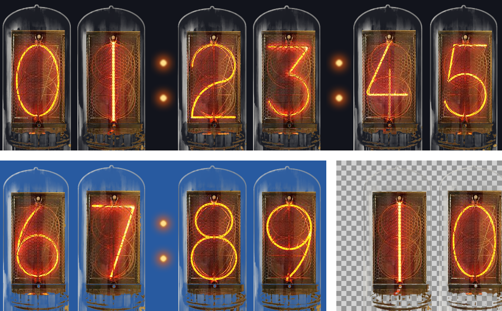
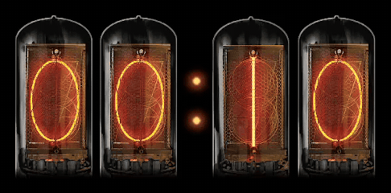
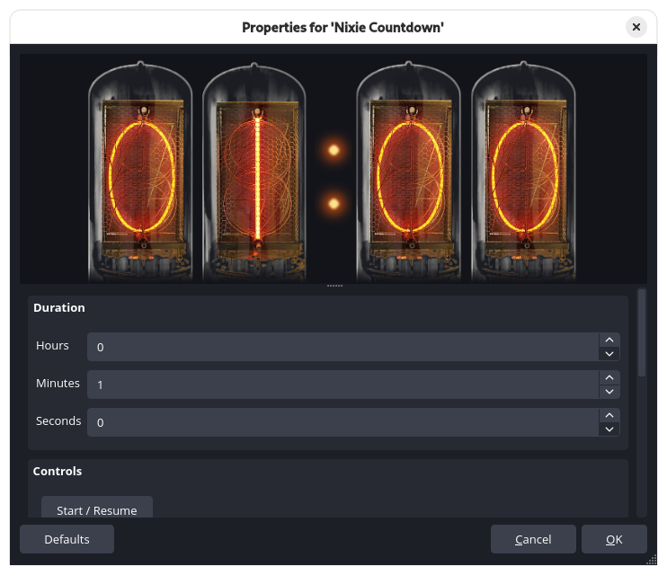
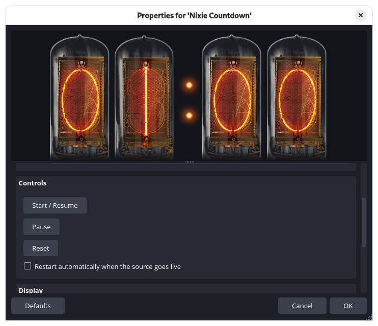
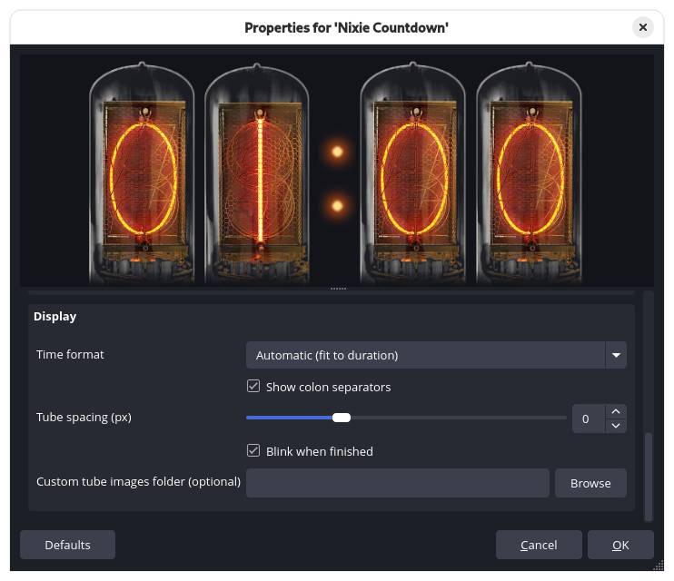
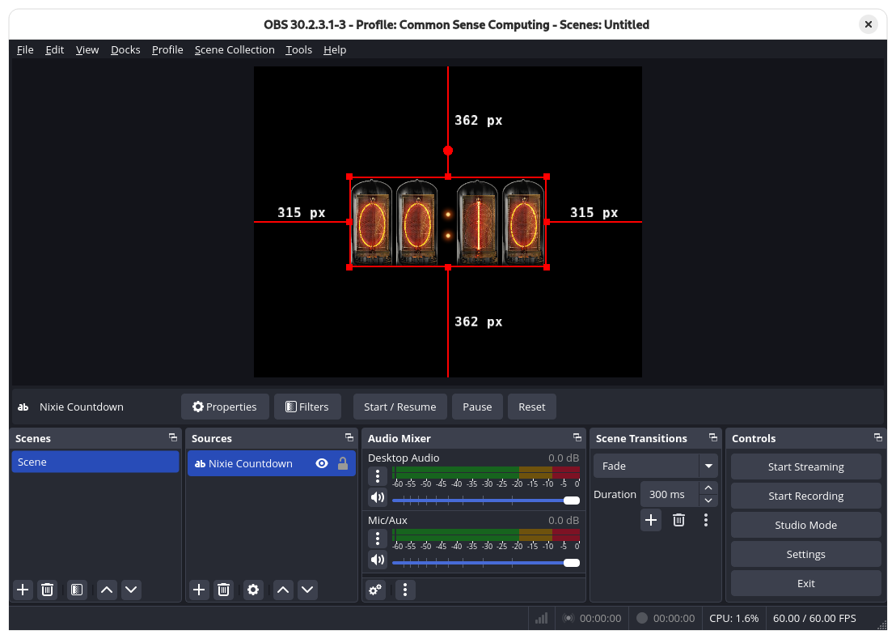

# Nixie Countdown

A countdown timer source that displays the time on photographic Nixie tubes, for Windows, macOS and Linux. See [Tested platforms](#tested-platforms).

This is a third-party plugin for OBS Studio. It is not made, endorsed or supported by the OBS Project.

**Upgrading from `obs-nixie-countdown`:** the plugin was renamed from `obs-nixie-countdown` to `nixie-countdown`. Remove the old plugin before installing this one, or OBS loads both:
- **Windows:** delete `C:\ProgramData\obs-studio\plugins\obs-nixie-countdown`.
- **macOS:** delete `~/Library/Application Support/obs-studio/plugins/obs-nixie-countdown.plugin`.
- **Linux:** the `.deb` package and `dev-install.sh` remove the old version automatically; otherwise delete `~/.config/obs-studio/plugins/obs-nixie-countdown`.

Your scenes keep working, because the source type didn't change.





## Features

- Set the duration in hours, minutes and seconds
- Display formats:
  - **Automatic**: picks the smallest format that fits the duration
  - **Seconds only**: `10`
  - **Minutes and seconds**: `00:10`
  - **Hours, minutes and seconds**: `00:00:10` (up to 999 hours)
- Start / Resume, Pause and Reset buttons right in the context bar under the preview
- Hotkeys for Start/Pause and Reset
- Optional restart whenever the source goes live
- Optional blink when the timer reaches zero
- Show or hide the colons and adjust the spacing between tubes
- Transparent tubes that sit cleanly over any scene
- Use your own tube images if you want a different look

## Requirements

OBS Studio 31 or newer for the downloadable packages. Building from source also works with OBS 30 (tested with 30.2.3 on Debian 13).

## Tested platforms

| Platform | OBS | Status |
| --- | --- | --- |
| Windows 10 Pro (CI build) | 33.0.1 | Tested: all automated checks of `verify-windows.ps1` pass ([report](../../issues/10)) |
| Debian 13, GNOME on Wayland (built from source) | 30.2.3 | Tested: all automated checks of `verify-linux-macos.py` pass ([report](../../issues/12)) |
| Fedora, Arch | | Builds and unit tests pass in CI; not yet tested in OBS |
| Debian 13 (`.deb`) | 30.x | Built by CI and installed in a Debian 13 container; not yet tested in OBS |
| Ubuntu 24.04 (`.deb`) | 31+ (OBS PPA) | Built by CI; not yet tested |
| Flatpak OBS (Flatpak extension) | | Built by CI; not yet tested |
| macOS | | Built by CI, **not yet tested on a Mac** |

**Testers wanted.** If you use OBS on macOS, or on Linux other than Debian, please try the plugin and report back. The [macOS testing issue](../../issues/2) and the [Linux testing issue](../../issues/16) say what to do. A verification script does the checking and opens a pre-filled report, and a report that everything works is just as helpful as a bug report.

## Download and install

Get the latest version from the [Releases](../../releases) page.

**Windows**

1. Download the `windows-x64.zip` file.
2. Extract it into `C:\ProgramData\obs-studio\plugins\`. You should end up with `C:\ProgramData\obs-studio\plugins\nixie-countdown\bin\64bit\nixie-countdown.dll`.
3. Restart OBS.

**macOS**

1. Download and run the `macos-universal.pkg` file.
2. The package is not signed, so macOS will block it the first time. Open System Settings > Privacy & Security and click **Open Anyway**.
3. Restart OBS.

**Debian and Ubuntu**

Each `.deb` only works on the system it was built for, because it depends on that system's own OBS and Qt packages:

| System | OBS | File |
| --- | --- | --- |
| Debian 13 | Debian's `obs-studio` package (30.x) | `nixie-countdown-*-debian-13-x86_64.deb` |
| Ubuntu 24.04 | OBS from the [official OBS PPA](https://launchpad.net/~obsproject/+archive/ubuntu/obs-studio) (31 or newer) | `nixie-countdown-*-ubuntu-24.04-x86_64.deb` |

```bash
sudo apt install ./nixie-countdown-*-debian-13-x86_64.deb      # Debian 13
sudo apt install ./nixie-countdown-*-ubuntu-24.04-x86_64.deb   # Ubuntu 24.04
```

On other Debian- or Ubuntu-based systems, build from source (see below).

**Flatpak OBS** (from Flathub)

```bash
flatpak install ./nixie-countdown-*-flatpak-x86_64.flatpak
```

This installs the plugin as an extension of the OBS Flatpak. If you installed OBS with `--user`, add `--user` here too.

**Other Linux distributions, including Fedora and Arch**: build from source (see below).

## Usage

1. In the Sources panel, click **+** and choose **Nixie Countdown**.
2. Set the duration and display format in the properties window.
3. Select the source to get **Start / Resume**, **Pause** and **Reset** in the context bar under the preview.
4. Optional: assign hotkeys under Settings > Hotkeys > "Nixie Countdown: Start/Pause" and "Nixie Countdown: Reset".

<p>
  
  
  
</p>

Resize the source with the transform handles like any other source. Its width is fixed from the duration you set, so it never changes size while counting down.

### Custom tubes

Point **Custom tube images folder** at a folder containing `0.png` through `9.png` and `colon.png`. All digit images should be the same size, with straight (non-premultiplied) alpha. Any missing file falls back to the built-in image.

### Context bar buttons

Select a Nixie Countdown source and **Start / Resume**, **Pause** and **Reset** appear in the context bar under the preview, next to Properties and Filters. You can control the timer without opening any windows.




## Building from source

Based on the official [obs-plugintemplate](https://github.com/obsproject/obs-plugintemplate). Requires CMake 3.28 or newer.

**Linux: Debian, Ubuntu, Fedora, Arch and their derivatives (quickest)**

```bash
git clone https://github.com/simulacra10/nixie-countdown.git
cd nixie-countdown
./dev-install.sh --run
```

This:
- checks the build dependencies, and offers to install any that are missing with apt, dnf or pacman (OBS, its development files, Qt 6, CMake, Ninja, GCC)
- builds the plugin and installs it into your user plugin folder
- launches OBS

Run `./dev-install.sh --help` for options. It installs for the native OBS package; for the Flatpak, use the `.flatpak` file from Releases, or build it with the manifest in [`flatpak/`](flatpak/).

**Any platform**

| Platform | Configure | Build |
| --- | --- | --- |
| Windows (Visual Studio 2022) | `cmake --preset windows-x64` | `cmake --build --preset windows-x64` |
| macOS (Xcode 16) | `cmake --preset macos` | `cmake --build --preset macos` |
| Linux | `cmake --preset ubuntu-x86_64` | `cmake --build --preset ubuntu-x86_64` |

The Windows and macOS presets download OBS and its dependencies automatically. On Linux, install `libobs-dev qt6-base-dev cmake ninja-build gcc g++ pkg-config` first.

Every push to `main` builds all three platforms in GitHub Actions. Pushing a version tag such as `1.2.0` creates a draft release with the packages attached.

## Testing

The timer and display logic (the time layout, clamping of settings, start / pause / reset and the blink at zero) is covered by unit tests in `tests/`. They need CMake and a C compiler, not OBS. GitHub Actions runs them on Ubuntu, macOS and Windows, and in Debian, Fedora and Arch containers, for every pull request, and a pull request can't be merged into `main` unless they pass.

**On Linux or macOS, without downloading the project:** download [`run-tests.sh`](run-tests.sh) and run `bash run-tests.sh`. It works the same way as the Windows script below:
- it offers to install CMake and a compiler with apt, dnf or pacman (on macOS: Homebrew and Apple's Command Line Tools)
- it downloads the test source for the requested commit, builds and runs the tests
- it offers to open a pre-filled test report

**On Windows, without downloading the project:**
1. Download [`run-tests.ps1`](run-tests.ps1).
2. In PowerShell, from the folder you saved it to, run:

   ```powershell
   powershell -ExecutionPolicy Bypass -File .\run-tests.ps1
   ```

The script:
- offers to install CMake and the Microsoft C compiler (Visual Studio Build Tools, about 2-3 GB) with winget if they're missing
- downloads the test source for the current `main` from GitHub into a temporary folder, and removes it afterwards
- builds and runs the tests
- offers to submit the results by opening a pre-filled **Test report** issue in your browser, which you check before it's posted

Use `-Ref <branch, tag or commit>` to test something other than `main`.

**From a clone of the project:**

| Platform | Command |
| --- | --- |
| Linux or macOS | `./run-tests.sh` |
| Windows | `.\run-tests.ps1` |

Add `--clean` (or `-Clean` on Windows) to rebuild from scratch.

### Verifying an installed plugin

The verification script checks a real OBS installation with the plugin installed. It starts OBS, drives a Nixie Countdown source through OBS's built-in remote control (obs-websocket), and checks that:
- the plugin loads
- the source has the right size in every format
- out-of-range settings are clamped
- Start, Pause and Reset work
- the countdown reaches zero and blinks
- the hotkeys work

At the end it offers to open a pre-filled **Test report** issue in your browser, with the results and the plugin's lines from the OBS log already filled in. It also combines the screenshots into one image and puts it on the clipboard, so pressing Ctrl+V in the report attaches it. Nothing is posted until you check the report and click Submit. A copy of everything stays in a report folder on your Desktop. Your own scenes and settings are left alone: the test runs in a temporary scene collection that is deleted afterwards, and the WebSocket settings are restored when OBS closes.

| Platform | Script |
| --- | --- |
| Windows 10 or 11, OBS 31 or newer | [`verify-windows.ps1`](verify-windows.ps1) |
| Linux (Debian, Ubuntu, Fedora, Arch and their derivatives), OBS 30 or newer, native or Flatpak | [`verify-linux-macos.py`](verify-linux-macos.py) |
| macOS, OBS 31 or newer | [`verify-linux-macos.py`](verify-linux-macos.py) |

On Windows, close OBS, download [`verify-windows.ps1`](verify-windows.ps1) (no git needed), and in PowerShell run, from the folder you saved it to:

```powershell
powershell -ExecutionPolicy Bypass -File .\verify-windows.ps1
```

On Linux or macOS, close OBS, download [`verify-linux-macos.py`](verify-linux-macos.py), and in a terminal run, from the folder you saved it to:

```bash
python3 verify-linux-macos.py
```

It needs only Python 3.8 or newer, which most Linux desktops include (otherwise install `python3`, or `python` on Arch). On macOS, the first `python3` command offers to install Apple's Command Line Tools, which include it.

Near the end, a box appears with one question: whether the buttons appear in the context bar, because that part can't be checked automatically. Add `-SkipManual` (Windows) or `--skip-manual` (Linux, macOS) to skip it. On Linux, the box uses zenity or kdialog when available.

The report contains your operating system and version (on Linux also the desktop and session type), the OBS and plugin versions, screenshots of the test source only, and the plugin's own lines from the OBS log. Read it in the browser before submitting: if you have set a custom tube images folder that couldn't be loaded, its path (which can include your user name) appears in those log lines, and you can delete it there.

## Planned

- Sound effects to go with the tube changes, such as a tick when the digits switch and an alarm when the countdown reaches zero

## Security audits

All code submitted to this project is security audited before it is committed to `main`, and every audit is logged, whether or not it finds anything. That includes pull requests.

The logs are in [security-log/](security-log/). Each one is a dated file in **CSAF 2.0** (ISO/IEC 20153), the international standard format for security advisories. Each finding records its CWE classification, location, failure scenario, fix and impact. [security-log/README.md](security-log/README.md) has a readable summary of each audit.

## Reporting issues

Open an issue on the [Issues](../../issues) page. Please include your OBS version, your operating system, and the lines containing `nixie` from your OBS log (Help > Log Files > Show Log Files).

## Credits

Nixie tube photograph by DANYK, from [danyk.cz/digitrony_en.html](https://danyk.cz/digitrony_en.html), used with credit under the author's reuse terms ([danyk.cz/cado_en.html](https://danyk.cz/cado_en.html)). The digits were cut from the photograph and placed on transparent backgrounds for this plugin.

**AI disclosure:** The code for this plugin was written by Claude (Anthropic's AI model) at my direction, including the C source, the Qt context bar integration and the build scripts. Claude also cut the tube digits from the source photograph, processed them onto transparent backgrounds, and generated the colon separator image. I designed the features, directed each revision, and tested it with OBS on Debian 13 and Windows 10.

## License

This project uses more than one license.

**MIT** ([LICENSE](LICENSE)): the plugin code written for this project:

- `src/nixie-countdown.c`
- `src/nixie-logic.c` and `src/nixie-logic.h`
- `src/context-bar.cpp`
- `src/plugin-main.c`
- `tests/` (the unit tests and their `CMakeLists.txt`)
- `dev-install.sh`, `run-tests.sh`, `run-tests.ps1`, `verify-windows.ps1` and `verify-linux-macos.py`
- `.github/workflows/unit-tests.yaml`
- `flatpak/` (the Flatpak manifest and metadata)

**GPL-2.0-or-later** ([LICENSE-GPL-2.0](LICENSE-GPL-2.0)): files from the [obs-plugintemplate](https://github.com/obsproject/obs-plugintemplate), including `src/plugin-support.h`, `src/plugin-support.c.in`, `CMakeLists.txt`, `CMakePresets.json`, `buildspec.json`, and the `cmake/`, `build-aux/` and `.github/` folders (except `unit-tests.yaml`).

**Built plugin:** the compiled plugin links against OBS (libobs), which is GPL-2.0-or-later, so the binaries in the release packages are distributed under the GPL-2.0-or-later. The MIT files can still be reused on their own under MIT.

**Tube images:** the images in `data/digits/` are derived from DANYK's photograph and are not covered by either license. See [Credits](#credits) and `data/digits/CREDITS.txt`.

Each source file names its license in an `SPDX-License-Identifier` line in its header.
